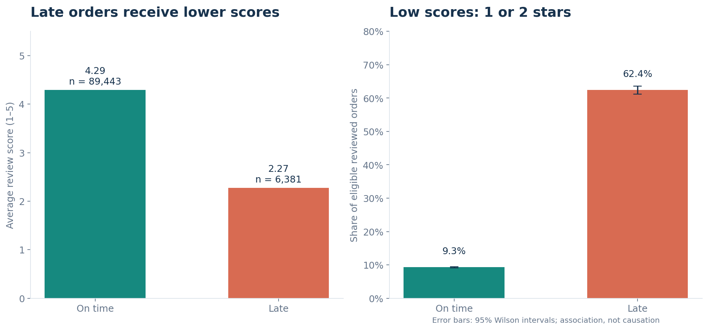

# Olist: sales, delivery and customer experience

A Python analysis of a Brazilian marketplace's historical order data. The
question is practical: **where should a marketplace team investigate delivery
experience while protecting its main sources of sales?**

The project combines nine CSV files, checks the relationships between them,
and produces a notebook, summary tables, six charts and an offline HTML report.

**Tools:** Python · pandas · NumPy · Matplotlib  
**Scope:** delivered orders for commercial analysis; all order statuses for the
data audit. Historical data from 2016–2018, not current Olist performance.

## Main findings

| Measure | Result |
|---|---:|
| Source orders | 99,441 |
| Delivered orders | 96,478 |
| Delivered product sales, excluding freight | R$13,221,498.11 |
| Product-only average order value | R$137.04 |
| Late deliveries / eligible deliveries | 6,534 / 96,470 (6.77%) |
| Average review: on time / late | 4.29 / 2.27 out of 5 |
| Low-score reviews: on time / late | 9.27% / 62.42% |
| Customers with 2+ observed delivered orders | 2,801 / 93,358 (3.00%) |



Late orders receive substantially poorer reviews. This supports an operational
investigation and a controlled customer-communication pilot; it does not prove
that a specific intervention would improve ratings by the historical gap.
Product sales measure merchandise value, not marketplace revenue or profit.

`health_beauty` leads product sales. The top 20% of delivered-order sellers
account for 82.3% of product sales, suggesting a useful group for service review.
Repeat purchasing is low in this extract; the cohort view keeps unequal
follow-up windows visible rather than interpreting every one-time buyer as
churned.

## Read the analysis

- [Analysis notebook](notebooks/01_olist_analysis.ipynb): saved outputs and explanations.
- [Business summary](reports/executive_summary.md): findings, actions and limitations.
- [HTML report](reports/executive_report.html): download/open locally in a browser; GitHub shows HTML source rather than hosting the report.
- [Metric definitions and data decisions](docs/DATA_NOTES.md).

## Run locally

Use Python 3.11 or newer; tested with Python 3.12.14. First extract the project
and open a terminal inside its folder.

```bash
python -m venv .venv
```

Activate the environment using `.venv\Scripts\activate` in Windows Command
Prompt, or `source .venv/bin/activate` on macOS/Linux. Then:

```bash
python -m pip install -r requirements.txt
python run_analysis.py
python -m unittest discover -s tests -v
```

The complete download includes raw CSVs. For the GitHub-ready version, follow
[the dataset instructions](data/README.md) to place all nine source files in
`data/raw/`. Alternatively, point the script to an existing folder:

```bash
python run_analysis.py --data-dir "path/to/csv-folder"
```

To refresh the notebook interactively:

```bash
python -m pip install -r requirements-notebook.txt
python -m notebook
```

Open `notebooks/01_olist_analysis.ipynb`, restart the kernel and run all cells.
The script rebuilds reports/tables; it does not rewrite saved notebook outputs.
See [START_HERE.md](START_HERE.md) for beginner-friendly instructions.

## How the analysis avoids double-counting

Items, payments and reviews can each contain multiple rows per order. Items
and payments are aggregated independently; the latest answered review is
selected before these tables join the unique order spine. Category sales use
a separate item view. Join validation and source reconciliations check that
the totals and row counts stay consistent.

Missing delivery dates stay unknown. Delivery compares calendar dates, so an
arrival on the promised date counts as on time. Eight delivered orders are
excluded from service metrics because of missing dates. One delivered order
lacks a payment record, and 256 have payment-versus-item differences above
R$0.05; these source values are preserved and diagnosed.

The advanced sections add cohort repeat purchasing, seller concentration,
Wilson intervals for low-score proportions, and an earliest/latest-review
sensitivity check. No predictive model is needed for the business question.

## Project files

| Location | Purpose |
|---|---|
| `run_analysis.py` | One command to rebuild results |
| `src/analysis.py` | Loading, joins, features, summaries and reconciliations |
| `src/charts.py`, `src/reporting.py` | Static charts and report generation |
| `notebooks/` | Guided analysis with saved outputs |
| `data/raw/` | Original local CSVs; ignored by Git |
| `outputs/tables/` | Aggregate results, quality diagnostics and source hashes |
| `reports/` | Six PNG charts, business summary and self-contained HTML |
| `tests/` | Eight small tests for joins, dates, reviews and cohorts |
| `docs/` | Dictionary, methods, validation, GitHub and interview guides |

The main script passed ten source reconciliation checks, and eight synthetic
tests passed. See [validation details](docs/VALIDATION.md).

## Source and attribution

[Brazilian E-Commerce Public Dataset by Olist](https://www.kaggle.com/datasets/olistbr/brazilian-ecommerce),
published by Olist and collaborators. Dataset and adapted data outputs:
[CC BY-NC-SA 4.0](https://creativecommons.org/licenses/by-nc-sa/4.0/).
Project code: [MIT](LICENSE). See [DATA_LICENSE.md](DATA_LICENSE.md) for the
scope of each licence. No Olist affiliation is claimed.
